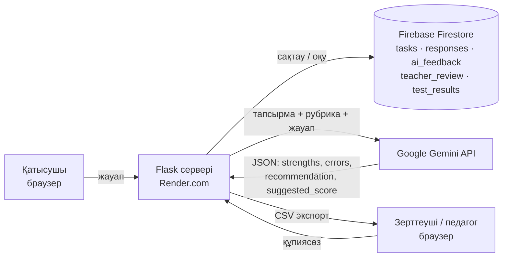

# JS-Тәлімгер

JavaScript негіздерін үйренушілерге арналған диагностикалық веб қосымша. Қатысушы тест пен практикалық
тапсырмаларды орындайды, жауабы Firebase Firestore бұлттық деректер қорында сақталады, ал Google Gemini
ЖИ моделі API арқылы рубрикаға сүйеніп кері байланыс береді. Педагог ЖИ нәтижесін тексеріп, түзетеді;
зерттеуші деректерді CSV («;» бөлгіш, Excel-де бірден бағандарға бөлінеді) немесе Excel (.xlsx) форматында жүктейді.

**Қатемен жұмыс:** кері байланыстан кейін қатысушы кодын 2 рет түзетіп қайта жібере алады (ЖИ қайта бағалайды, бастапқы жауап өзгермейді) және ЖИ-ден 2 рет дайын шешімсіз кеңес сұрай алады. Талпыныстар `responses` жинағында `R-XXXXXXXX-2`, `-3` кодтарымен, кеңестер `hints` жинағында сақталады.

Жоба «Педагогикалық зерттеулерді ұйымдастырудағы бұлтты технологиялар» пәні бойынша 1-аралық бақылау
жобасы ретінде әзірленді. Диссертация тақырыбы: «JavaScript бағдарламалау тілін ЖИ көмегімен оқытуға
арналған онлайн платформа».

## Архитектура



Жұмыс тәртібі:
1. Қатысушы браузерде жауап енгізеді.
2. Сервер міндетті өрістерді және жауап көлемін (15–5000 таңба) тексереді.
3. Жауап `responses` жинағына бірегей `response_id` арқылы сақталады. ЖИ істемей қалса да жауап жоғалмайды.
4. Сервер тапсырма мен рубриканы деректер қорынан алып, ЖИ сұранысын құрастырады.
5. Gemini жауабының құрылымы мен балл аралығы тексеріледі, нәтиже `ai_feedback` жинағына жазылады.
6. Нәтиже интерфейсте «ЖИ ұсынған, педагог тексермеген кері байланыс» белгісімен көрсетіледі.
7. Педагог бағасы `teacher_review` жинағында бөлек сақталады, ЖИ нәтижесі өзгертілмейді.

API кілті тек сервердің орта айнымалысында сақталады және браузерге ешқашан жіберілмейді.

## Файлдар құрылымы

| Файл | Мазмұны |
|---|---|
| `app.py` | Flask сервері: беттер, жауап қабылдау, ЖИ шақыру, педагог тексеруі, CSV экспорт |
| `ai_service.py` | ЖИ нұсқаулығы (prompt), Gemini API сұранысы, жауап құрылымын тексеру |
| `storage.py` | Firestore қабаты (әзірлеуге арналған жергілікті JSON нұсқасы да бар) |
| `tasks_data.py` | 10 сұрақтық тест, 3 практикалық тапсырма, рубрикалар, жиі кездесетін қателер |
| `templates/`, `static/` | HTML, CSS, JavaScript интерфейсі |
| `tests/test_app.py` | Техникалық сынақ жағдайларының автотесттері |
| `check_ai.py` | Серверден ЖИ API-іне қысқа сынақ сұранысын жіберу |
| `render.yaml` | Render.com бұлттық платформасына орналастыру баптауы |

## Деректер құрылымы (Firestore)

| Жинақ | Құжат коды | Сақталатын деректер |
|---|---|---|
| `tasks` | `TEST1`, `P1`–`P3` | тапсырма мәтіні, критерийлер, ең жоғары балл, нұсқасы, күтілетін жауап |
| `responses` | `R-XXXXXXXX` | қатысушы коды, тапсырма коды мен нұсқасы, жауап мәтіні, жіберілген уақыт, ЖИ мәртебесі |
| `ai_feedback` | `R-XXXXXXXX` | strengths, errors, recommendation, criteria_scores, suggested_score, needs_review, модель, сұраныс нұсқасы |
| `teacher_review` | `R-XXXXXXXX` | педагог бағасы, түзетілген кері байланыс, түсініктеме, айырмашылық себебі, тексеру мәртебесі |
| `test_results` | қатысушы коды | әр сұрақтың нәтижесі мен тақырыбы, жалпы балл |

`response_id` қатысушы коды мен тапсырма кодынан есептеледі, сондықтан қайта жіберу көшірме жасамайды.

## Жергілікті іске қосу (Windows, PowerShell)

```powershell
pip install -r requirements.txt
$env:AI_PROVIDER = "mock"            # кілтсіз тексеру; нақты ЖИ үшін "gemini" + GEMINI_API_KEY
$env:STORAGE = "local"               # Firebase-сіз; бұлт үшін FIREBASE_CREDENTIALS_JSON беріңіз
$env:RESEARCHER_PASSWORD = "өз-құпиясөзіңіз"
python app.py
```

Қосымша http://localhost:5000 мекенжайында ашылады. Зерттеуші беті: `/researcher`.

Автотесттерді іске қосу:

```powershell
python -m pytest -q
```

## Бұлтта іске қосу

### 1. Firebase Firestore
1. https://console.firebase.google.com сайтында жаңа жоба құрыңыз.
2. **Build → Firestore Database → Create database** (production mode, аймақ: `eur3` немесе жақын аймақ).
3. **Project settings → Service accounts → Generate new private key** — JSON файлы жүктеледі.
   Бұл файлды репозиторийге салмаңыз және ешкімге жібермеңіз.

### 2. Gemini API кілті
https://aistudio.google.com сайтында **Get API key → Create API key**. Кілтті тексеру:

```powershell
$env:GEMINI_API_KEY = "кілт"
python check_ai.py
```

### 3. Render.com
1. Кодты GitHub репозиторийіне жүктеңіз (`.gitignore` кілт файлдарын жібермейді).
2. Render → **New → Blueprint** → репозиторийді таңдаңыз (`render.yaml` автоматты оқылады).
3. Құпия айнымалыларды енгізіңіз:
   - `GEMINI_API_KEY` — Gemini кілті;
   - `FIREBASE_CREDENTIALS_JSON` — сервистік аккаунт JSON файлының толық мәтіні;
   - `RESEARCHER_PASSWORD` — зерттеуші бетінің құпиясөзі.
4. Deploy аяқталғаннан кейін берілген сілтемені басқа браузерден ашып, жауап жіберу, ЖИ кері байланысы
   және CSV экспорт жұмысын тексеріңіз. Зерттеуші бетінде «Деректер қоры: Firebase Firestore (бұлт)» деп
   көрсетілуі тиіс.

Ескерту: Render-дің тегін жоспарында сервер 15 минут белсенділік болмаса ұйқыға кетеді, келесі ашылуы
шамамен 1 минут алады. Қорғау алдында сайтты алдын ала ашып қойыңыз.

## Орта айнымалылары

| Айнымалы | Мақсаты |
|---|---|
| `GEMINI_API_KEY` | Gemini API кілті (тек серверде) |
| `GEMINI_MODEL` | Модель атауы, әдепкі `gemini-3.8-flash` |
| `GROQ_API_KEY` | Қосалқы тегін ЖИ (Groq) кілті: Gemini модельдері жауап бермесе қолданылады |
| `BACKUP_AI_MODEL` | Қосалқы ЖИ моделі, әдепкі `openai/gpt-oss-120b` (`BACKUP_AI_URL`, `BACKUP_AI_KEY` арқылы басқа OpenAI-үйлесімді сервисті қосуға болады) |
| `GEMINI_FALLBACK_MODELS` | Негізгі модельдің лимиті бітсе (HTTP 429/503) қолданылатын модельдер, әдепкі `gemini-3.1-flash-lite` |
| `AI_PROVIDER` | `gemini` немесе `mock` |
| `FIREBASE_CREDENTIALS_JSON` / `GOOGLE_APPLICATION_CREDENTIALS` | Firestore-ға қосылу кілті (мәтін немесе файл жолы) |
| `STORAGE` | `auto`, `firestore` немесе `local` |
| `RESEARCHER_PASSWORD` | Зерттеуші бетінің құпиясөзі |
| `SECRET_KEY` | Сессия кілті |
| `SESSION_COOKIE_SECURE` | HTTPS кезінде `1` |

## Есеп пен құжаттар

`docs/` қалтасында тапсырылатын құжаттар бар:

| Файл | Мазмұны |
|---|---|
| `Есеп_1-аралық_жоба.docx` | 6–8 беттік есеп (титул бетімен) |
| `Қосымша_А_Тапсырмалар_мен_рубрика.docx` | Тест, практикалық тапсырмалар, рубрикалар |
| `Қосымша_Ә_ЖИ_қолдану_журналы.docx` | ЖИ қолдану журналы, сұраныс мәтіні, жауап үлгісі |
| `Таныстырылым_1-аралық_жоба.pptx` | 6 слайдтық таныстырылым (спикер жазбаларымен) |

Сары түспен белгіленген `[...]` орындарын өз мәліметтеріңізбен толтырыңыз.

Модельдік жауаптарды нақты Gemini арқылы талдап (`pilot/`), құжаттарды нәтижемен қайта құрастыру:

```powershell
$env:GEMINI_API_KEY = "кілт"
python pilot/run_pilot.py
cd docs/_build
npm install
npm run build
```

`pilot/pilot_results.csv` — анонимдендірілген CSV деректер үлгісі (Қосымша Б).

## Техникалық сынақ жағдайлары

| Сынақ жағдайы | Күтілетін нәтиже | Автотест |
|---|---|---|
| Дұрыс жауап | ЖИ дұрыс тұстарды көрсетеді | `test_correct_answer_is_saved_and_feedback_shown` |
| Бос жауап | Жауап енгізу сұралады, ештеңе сақталмайды | `test_empty_answer_is_rejected` |
| API қатесі | Жауап сақталады, түсінікті хабарлама шығады | `test_api_error_keeps_answer_and_shows_message` |
| Қайта жіберу | Көшірме жасалмайды | `test_resubmission_does_not_create_duplicates` |
| ЖИ құрылымы бұзылған | Нәтиже тексерілмеген деп белгіленеді | `test_invalid_ai_structure_marked_unverified` |
| Рұқсатсыз зерттеуші бетіне кіру | Қолжетімділік берілмейді | `test_researcher_pages_require_login` |
| Педагог тексеруі мен экспорт | Бағалар бөлек сақталады, CSV-ге шығады | `test_teacher_review_stored_separately_and_exported` |

Жартылай дұрыс және қате жауаптарға берілетін кері байланыстың педагогикалық сапасы нақты Gemini
моделімен қолмен тексеріледі және есепте сипатталады.
